# SoTI — Threat Intelligence Enrichment CLI & SOC Workbench

**SoTI (Threat Intelligence Enrichment & IOC Assessment Workbench)** is a full-stack threat intelligence enrichment and indicator-of-compromise (IOC) triage platform combining a **Python CLI** and an interactive **React + Express SOC Web Workbench**. It enables security analysts to inspect normal and defanged **IPv4/IPv6 addresses, domains, URLs, and file hashes** (`MD5`, `SHA1`, `SHA256`) across **VirusTotal**, **AbuseIPDB**, **AlienVault OTX**, **Shodan**, **ThreatFox**, **URLScan.io**, and configurable custom threat intelligence APIs.

**Created and developed by Mohammad Hossein Sokhanfar**  
Repository: [https://github.com/MHSokhanfar/SoTI](https://github.com/MHSokhanfar/SoTI)

---

## 1. Project Overview

SoTI bridges lightweight command-line threat lookups with an interactive SOC browser workbench:
- **Automatic IOC Parsing & Defanging Recovery**: Recognizes and refangs indicators such as `1[.]2[.]3[.]4`, `hxxps://evil[.]example/login`, and hashes across single-input, CSV upload, and multi-line bulk triage.
- **Multi-Provider Enrichment & Failover**: Aggregates telemetry across VirusTotal, AbuseIPDB, AlienVault OTX, Shodan, ThreatFox, URLScan.io, and custom HTTP endpoints with daily quota tracking and automatic failover when a provider nears exhaustion or returns `HTTP 429`.
- **Weighted Confidence Risk Scoring**: Computes normalized `0–100` threat confidence scores and verdicts (`Critical`, `High`, `Medium`, `Low`, `Clean`, `Unknown`) per indicator and provider finding.
- **Dual Execution Modes**: Run completely offline in deterministic **Sample / Demo mode** (zero external quota used) or connect real API keys for **Live API** intelligence lookups.

---

## 2. Prerequisites

Install the following before setting up SoTI locally:

| Prerequisite | Recommended Version | Purpose |
| :--- | :--- | :--- |
| **Git** | `2.30+` | Clone the repository |
| **Python** | `3.10+` with `pip` | Run the Python CLI (`main.py`) and Python unit tests |
| **Node.js & npm** | `Node.js 22+` (`22 LTS` recommended) | Run the Express backend (`server.ts`), React/Vite Web Workbench, TypeScript unit tests, and production builds |
| **Threat Intel API Keys** | Free or standard tier | Live lookups against VirusTotal, AbuseIPDB, AlienVault OTX, Shodan, ThreatFox, URLScan *(optional for offline Demo / Sample mode)* |
| **Gemini API Key** *(Optional)* | Standard AI Studio / Gemini key | Server-side AI executive summary generation in the Web Workbench Reports view (`GEMINI_API_KEY`) |

---

## 3. Installation Guide

### Step 1: Clone the Repository
```bash
git clone https://github.com/MHSokhanfar/SoTI.git
cd SoTI
```

### Step 2: Create and Activate a Python Virtual Environment
- **Linux / macOS:**
  ```bash
  python3 -m venv venv
  source venv/bin/activate
  ```

- **Windows — Command Prompt (CMD):**
  ```cmd
  python -m venv venv
  venv\Scripts\activate.bat
  ```

- **Windows — PowerShell:**
  ```powershell
  python -m venv venv
  .\venv\Scripts\Activate.ps1
  ```
  > **Windows Note:** If PowerShell blocks script execution, allow local scripts once for your user and re-run activation:
  > `Set-ExecutionPolicy -Scope CurrentUser RemoteSigned`

### Step 3: Install Python Dependencies (`requirements.txt`)
With `(venv)` active, install the CLI packages (`requests`, `python-dotenv`, `rich`):
```bash
pip install --upgrade pip
pip install -r requirements.txt
```

### Step 4: Install Web Workbench Dependencies (`package.json`)
Install the Node.js, React, D3, Express, and TypeScript packages required by the Web Workbench:
```bash
npm install
```

---

## 4. API Configuration

You can configure threat intelligence API keys **either via `.env` on disk** or **directly inside the Web Workbench GUI**.

### Option A: Configure via `.env` (CLI & Web Workbench)
Copy `.env.example` to `.env`:
- **Linux / macOS:** `cp .env.example .env`
- **Windows (CMD / PowerShell):** `copy .env.example .env`

Edit `.env` with your keys:
```env
# Primary Threat Intelligence API Keys (Python CLI & Web Workbench)
VT_API_KEY=your_virustotal_api_key
ABUSEIPDB_API_KEY=your_abuseipdb_api_key
OTX_API_KEY=your_alienvault_otx_api_key

# Extended Threat Intelligence Providers
SHODAN_API_KEY=your_shodan_api_key
THREATFOX_AUTH_KEY=your_threatfox_auth_key
URLSCAN_API_KEY=your_urlscan_api_key

# Optional AI Executive Summary & Email Alerting (Server-Side Only)
GEMINI_API_KEY=your_gemini_api_key
SMTP_HOST=smtp.example.com
SMTP_PORT=587
SMTP_SECURE=false
SMTP_USER=alerts@example.com
SMTP_PASS=your_smtp_password
SMTP_FROM=soti-alerts@example.com
```

### Option B: Configure Threat Intel API Keys Directly from the Web Workbench GUI
1. Launch and open the **Web Workbench** (`http://localhost:3000`).
2. Switch to the **CLI & APIs** tab (or press `Alt+5`).
3. Locate any Core (**VirusTotal**, **AbuseIPDB**, **AlienVault OTX**), Built-in Extended (**Shodan**, **ThreatFox**, **URLScan**), or **Custom Integration** card.
4. Paste your provider API key into the masked **API Key** input and click **Save Key** (use the eye icon to toggle visibility or **Clear Key** to remove a stored key).
5. Keys saved from the GUI are persisted server-side in `config/provider_keys.json` (gitignored), immediately update `process.env` and the live TopBar status indicator (`Configured ••••xxxx`), and are never exposed back to browser storage.

> **Security Note:** `.env` and `config/provider_keys.json` are excluded via `.gitignore` and never expose raw secret values to client browsers.

---

## 5. How to Run & Use the Web Workbench

The **Web Workbench** pairs an Express backend (`server.ts` serving API endpoints, CSV archive streaming, scheduled checks, email alerting, Gemini AI summaries, and temporary shared reports) with a React + Vite + Tailwind CSS + D3.js frontend on **port `3000`**.

### Starting the Web Workbench

> Make sure **Node.js 22+** is installed and you have run `npm install` in the project root (`SoTI/`).

#### 1. Development Mode (Interactive Local Workbench)
From the project root:
```bash
npm run dev
```
This starts `tsx server.ts` on port `3000` with Vite middleware attached. Open:
**[http://localhost:3000](http://localhost:3000)**

> **Offline Evaluation Without Keys:** You can launch `npm run dev` immediately—even before configuring API keys—and switch **Sample Data** on inside the Investigate bar to test single lookups, Bulk Input triage, Live Mode polling, D3 visualizations, and exports without consuming external API quota.

#### 2. Production Mode (Compiled Static Bundle + Express API)
Build the frontend assets into `dist/` and start the Express server:
```bash
npm run build
npm start
```
Then open **[http://localhost:3000](http://localhost:3000)**.

### Web Workbench Walkthrough by Workspace Tab

1. **Investigate (`Ctrl+I` or `Alt+1`)**
   - **Data Source (`Sample Data` vs `Live API`)**: Toggle **Sample Data** for offline deterministic triage (zero external quota consumed) or **Live API** to query configured threat intelligence providers.
   - **Header `Share` Context Dialog**: Click **`Share`** in the **Threat Intelligence Enrichment** header bar at any time to open the **Share Investigation Context** browser dialog—summarizing active filters (`Verdict`, `Tag`, `Risk Threshold`, `Sort Order`), workflow mode, and results while generating a `#soti_snapshot=...` URL ready for one-click **Copy Link** (`navigator.clipboard`), **Update Address Bar URL**, or native **Browser Share...** (`navigator.share`).
   - **Standard vs Bulk Input Mode & CSV-to-Bulk Upload**:
     - **Standard Mode**: Enter single or comma/space/newline-separated IPs, domains, URLs, or hashes (supports defanged syntax like `1[.]2[.]3[.]4` and `hxxps://evil[.]com`).
     - **Local CSV / TXT File Upload → Automatic Bulk Investigation Input**: Click **Import CSV** or **Choose CSV / TXT File** (or drag and drop a `.csv`/`.txt` file) to extract and refang indicators locally in the browser, deduplicate tokens, automatically switch into **Bulk Input**, and load the clean one-per-line IOC list directly into the Bulk Investigation textarea with instant IP/Domain/Hash counts.
     - **Bulk Input Mode**: Paste multiple indicators separated by **newlines** into the multi-line editor, inspect the real-time **lines / valid / invalid** indicator counts, click **Split to Lines** or **Clean & Deduplicate** to normalize mixed input, and run simultaneous concurrent provider enrichment across the entire batch into a consolidated **Unified Batch** table.
   - **Live Mode (Periodic Background Polling)**:
     - Toggle the **Live Mode** switch ON whenever you have active indicators to continuously monitor for score or verdict changes in the background.
     - Choose a polling cadence (`15s`, `30s`, `60s`, or `5m`), watch the real-time **`Next refresh in Xs (HH:MM:SS UTC)`** countdown and last-refresh timestamp in the status strip, or click **Refresh Now** for an immediate poll without creating duplicate history cards or redundant CSV reports.
   - **Providers, Risk Threshold & Inspection**: Select active providers (**VirusTotal**, **AbuseIPDB**, **AlienVault OTX**, **ThreatFox**, **URLScan**, plus enabled custom sources), dial the **Risk Threshold** slider (`0–100` with `All`, `25+`, `50+`, `75+` presets) to hide low-impact IOCs from both the **Summary Matrix** and **Unified Batch** tables, inspect the **Confidence Score Legend**, per-row **Historical Confidence Trend Mini-Sparklines** (highlighting rising `Emerging` threat signals across past CSV reports, history, and Live Mode polls), D3 **Attack Infrastructure Network Graph**, and **Chronological IOC Activity Timeline** (`Creation Date`, `Domain Registered`, `First Seen`, `Last Seen`, `Last Reported`, `Last Analysis`).
   - **Interactive Column Sorting, Last Seen, Quick Copy, Auto-Saved Notes, Session Snapshot & Export Dropdown**: Click any sortable column header (**`Indicator`**, **`Type`**, **`Source`**, **`Verdict`**, **`Risk Score`**, **`Last Seen`**, **`Score`**, or **`Hits`**) in either the **Summary Matrix** or **Unified Batch** table to toggle ascending/descending order (`aria-sort` + directional indicators) for rapid threat prioritization. Click the inline **Copy to Clipboard** icon next to any indicator value in every row to copy the raw IOC (`1.2.3.4`, `evil.com`, hash) for external security tools (or use **Copy** for the formatted provider summary). Click **`+ Tag`** on any row or IOC card to assign presets (`Phishing`, `Malware`, `Critical`, `C2`, `Ransomware`, `False Positive`) or custom labels, filter results by tag and verdict, and record **Researcher Notes**—which **auto-save periodically to `localStorage`** (with debounced writes, a 3-second periodic timer, and `beforeunload` flush, showing `"Auto-saved to local storage · HH:MM:SS UTC"`). Click **`Share`** in the header or **`Session Snapshot`** in the results toolbar to serialize your active investigation results, input tokens, provider selections, tag/verdict/risk filters, sort order, tags, and Researcher Notes into a shareable browser-based link (`#soti_snapshot=...`), allowing collaborators or returning sessions to pick up immediately where you left off. Open the **`Export Data`** dropdown menu to export the currently sorted & filtered table view to **`Export CSV (.csv)`**, **`Export JSON (.json)`**, or **`Export TXT Report (.txt)`**, click **`Print / PDF`** for a clean print-formatted PDF layout via `@media print` rules in `index.css`, or export the complete workbench bundle via **Export Full Session**.
   - **TopBar Global Search (`Preview` & `Clear`), `Privacy Mode` & Multi-Provider API Latency Popover**:
     - Focus **Global Search** (`Ctrl+K` / `/`) to search across active IOCs, recent sessions, CSV reports, scheduled checks, audit logs, and providers (including defanged IOC normalization such as `1[.]2[.]3[.]4`). Hovering over or arrow-stepping across any result immediately opens an inline **Risk Metadata Preview** displaying the verdict status, `0–100` confidence score meter, primary detection metric, contributing sources, UTC observation timestamp, and threat finding snippet without navigating away. Click **`Clear`** in the search dropdown filter bar at any time to purge `localStorage` recent investigation history (`soti_recent_investigations_v1`) and immediately clean stale session entries from the live search index.
     - Click **`Privacy`** / **`Masked`** in the global header bar at any time to toggle **Privacy Mode** (`soti_privacy_mode_v1` in `localStorage`). When active, a persistent amber banner (`Privacy Mode Active — Reveal Original IOCs`) appears and every IPv4/IPv6 address, domain, URL, defanged token (`1[.]2[.]3[.]4`, `hxxp://...`), and file hash is replaced at render time with `[REDACTED-IP]`, `[REDACTED-DOMAIN]`, `[REDACTED-URL]`, or `[REDACTED-HASH]` across the input box, results tables, D3 network/relationship graphs, event timeline, Researcher Notes, Recent/Watchlist sidebars, Quick Notes, Reports, Scheduled checks, Logs, and alert toasts without modifying stored data.
     - Inspect real-time status dots for **Core** providers (`VT`, `Abuse`, `OTX`), **Other Extended** providers (`Shodan`, `TFox`, `URL`), and user-defined **Custom Threat Intel APIs**; click the status pill to expand the **Threat Intelligence API Status** popover, run inline **`Test`** checks, monitor measured round-trip **`ms` latency indicators** (color-coded **Fast `< 400ms`**, **Moderate `400–1199ms`**, and **Slow `>= 1200ms`**) right in the TopBar and per provider, or jump to **CLI & APIs**.
   - **Custom `Alert Rules` Configuration & Automated Triggers**: Open **Alert Rules** from the Investigate action bar, the Notification Center **`Alert Rules`** tab, or **CLI & APIs** (`Alt+5`) to define multi-condition triggers by indicator type (`All`, `IP`, `Domain`, `Hash`, `URL`), minimum weighted risk score (`1–100`), verdict scope, optional substring pattern, and delivery channel (**Desktop**, **Email**, or **Both**). Rules evaluate automatically after every Investigate enrichment and Scheduled run, firing in-app **Desktop Alert Rule Toasts**, optional browser `Notification` popups, Notification Center alerts, **Email** dispatches via `POST /api/alerts/rules/dispatch`, and a persistent **Rule Trigger History** log.
   - **Tabbed Sidebar (`Recent`, Persistent `Watchlist`, & `Quick Notes`)**:
     - **Recent**: Browse local investigation history with right-click **Pin / Rename / Delete**, tag filtering, D3 heatmap geographic region filtering, one-click **`Export`** (downloading investigation IDs, UTC creation timestamps, modes, and verdict counts as `soti_investigation_history_*.json`), and a safeguarded **`Clear History`** confirmation dialog with **`Export JSON First`** protection.
     - **Watchlist**: Stored in top-level application state and synced to `localStorage` across sessions and tab switches—toggle **`Watch`** / **`Watching`** directly on any IP address, domain, or file hash row or IOC card in the results view, add indicators manually, run **Check Updates** on demand, view status/score transition deltas (`Verdict Clean -> Malicious · Score 0 -> 79`), and clear unread counters from the red **notification badge** on the Watchlist tab.
     - **Quick Notes**: Collapsible sticky scratchpad directly beneath **Recent / Watchlist** (and accessible from **any** workspace tab via the top-bar **`Quick Notes`** slide-over drawer) that immediately persists transient analyst hypotheses, pivot commands, and triage reminders across browser sessions via `localStorage` with live character count, **Copy**, and **Clear** (with **Undo** recovery).

2. **Reports (`Alt+2`)**
   - Review SOC **Quick Stats** KPIs, the real-time **Live Activity** scrollable feed, verdict distribution charts, **30-day alert trendline**, D3 **Risk Score Heatmap**, D3 **Relationship Graph**, D3 **Real-Time Threat Landscape World Map**, and interactive D3 **Geographic Region IOC Heatmap**.
   - **Risk Score Heatmap (`RiskScoreHeatmap`)**: D3 matrix directly beneath the historical trend charts visualizing **High (`50–100`)**, **Medium (`25–49`)**, and **Low (`0–24`)** risk score distribution across all processed investigations (`Across Investigations` timeline or aggregated `By Indicator Type` across IPs, Domains, and File Hashes), complete with a 5-column **Overall Posture** KPI strip (`Critical`, `Elevated`, `Moderate`, `Low`) and clickable cells for **Inspect Run** and **Filter Table** drill-down.
   - **Live Activity Scrollable Feed (`LiveActivityFeed`)**: Streams real-time **Threat Alerts** (high-confidence detections and threshold emails), **Investigations** (completed enrichments and saved CSV runs), and **System Events** (`logs/soti.log` telemetry and rate-limit events) over Server-Sent Events (`/api/activity/stream`) into a bounded scrollable feed (`max-h-[300px] overflow-y-auto`). Filter by category tabs (`All Activity`, `Threat Alerts`, `Investigations`, `System Events`), search inline, pause/resume the live stream, or click **Filter IOC** / **Open Run** to pivot immediately.
   - **Dashboard Relationship Graph (`RelationshipGraphWidget`)**: Interactive D3 force-directed network map connecting IPs, shared domains, file hashes, malware families, and ASN infrastructure across **`All Runs & Active`**, **`Selected Run`**, or **`Active Session`**. Toggle **`Shared Links Only`** or click any **`Shared Infrastructure Hubs`** spotlight button (`1.2.3.4`, `evil.com`, `eicar.com`, etc.) to highlight cross-indicator hubs with dashed amber rings and inspect connected entities with **Copy Value** and **Filter Reports** actions.
   - **Real-Time D3 World Map (`ThreatLandscapeWidget`)**: Displays geolocated active IOC origin points overlaid on a Natural Earth projection with optional 30-second **Real-Time Sync** polling; hover any **continental landmass region** or **origin marker** to inspect live threat counts, peak confidence score, and top source countries, or switch scopes (`Active IOCs (Real-Time)`, `All Runs`, `Selected Run`, `Current Investigation`) and confidence thresholds.
   - Click any geographic region label or cell on the heatmap and choose **Filter Recent Investigations** to pivot directly to matching IOCs in the Investigate sidebar.
   - Click **Generate Summary** to draft a natural-language executive summary via Gemini AI (`GEMINI_API_KEY` server-side).
   - Click **Download Summary** to generate and download a consolidated executive risk PDF (`soti_risk_summary_YYYY-MM-DD.pdf`) combining overall security posture KPIs, the captured **30-day risk trendline** SVG chart, the **Risk Score Heatmap** High/Medium/Low distribution & indicator-type breakdown, optional AI brief excerpt, and the top ranked malicious indicators across archived runs and active findings (automatically honoring **Privacy Mode** redaction when enabled).
   - Click **Share Report** to create a temporary expiring share link (`/?share=<token>`, TTL options from 1 hour to 7 days) alongside a copy-ready team summary message.
   - Click **Download PDF** or **Export Aggregated CSV**, tune **Auto-refresh** (`60s` default), and adjust table **Density** (`Compact`, `Normal`, `Spacious`).

3. **Scheduled (`Alt+3`)**
   - Create recurring interval monitoring jobs across IOCs and sources, inspect next-run timers, or execute due schedules immediately.

4. **Logs (`Alt+4`)**
   - Inspect real-time audit logs (`logs/soti.log`), API lookup outcomes, rate-limit warnings, and quota failover events.

5. **CLI & APIs (`Alt+5`)**
   - Add, update, or clear Threat Intel API keys directly in the GUI, manage custom risk/verdict **Alert Rules** (`AlertRulesPanel`), configure global SMTP email threshold alerts (`EmailAlertSettingsPanel`), monitor daily API quota headroom, inspect CLI command presets, and register custom provider endpoints.

### Global Keyboard Shortcuts

Press `Shift+?` anywhere outside text inputs (or click the keyboard icon in the top bar) to view all shortcuts:

| Shortcut | Action |
| :--- | :--- |
| `Ctrl+K` / `Cmd+K` or `/` | Focus **Global Search** across IOCs, reports, schedules, and logs |
| `Ctrl+I` / `Cmd+I` | Switch to **Investigate** and focus the IOC input box |
| `Alt+1` – `Alt+5` | Switch between **Investigate**, **Reports**, **Scheduled**, **Logs**, and **CLI & APIs** |
| `Alt+T` | Toggle **Light / Dark** theme |
| `Shift+?` | Open or close the **Keyboard Shortcuts** reference modal |
| `Esc` | Dismiss active modals or drawers |

---

## 6. Python CLI Usage (`main.py`)

With `(venv)` activated:

### Interactive Menu Mode
```bash
# Live API lookups
python main.py

# Offline deterministic demo mode (no API quota consumed)
python main.py --demo
```

### Non-Interactive CLI Commands
```bash
# Query multiple defanged/standard indicators across all configured sources
python main.py --source all --indicators "1[.]2[.]3[.]4, hxxp://evil[.]com, 44d88612fea8a8f36de82e1278abb02f"

# Query a single IP address using VirusTotal only
python main.py --source vt --indicators 8.8.8.8

# Load indicators from a text or CSV file
python main.py --source all --file indicators.txt

# Offline simulation with machine-readable JSON output
python main.py --source all --indicators "8.8.8.8, evil[.]com" --demo --json
```

### Scheduled Checks via CLI
```bash
python main.py --add-schedule --schedule-name "Critical IOC Watch" --source all --indicators "1[.]2[.]3[.]4, evil[.]com" --interval 60
python main.py --list-schedules
python main.py --run-due
python main.py --remove-schedule <SCHEDULE_ID>
```

---

## 7. Recently Added Features

- **TopBar API Test Latency Indicator (`TopBar`, `CliSetupView` & `apiConfig`)**: Measures and displays real round-trip latency in milliseconds (`ms`) on the TopBar API status pill after any provider test call (from either the TopBar popover **`Test`** buttons or **CLI & APIs**), alongside per-provider latency readouts inside the **Threat Intelligence API Status** popover with speed-tier highlighting (**Fast `< 400ms`**, **Moderate `400–1199ms`**, **Slow `>= 1200ms`**) to spot slow upstream feeds immediately.
- **Global Search Dropdown `'Clear'` Recent History Button (`TopBar`, `App`, `InvestigateView` & `globalSearch`)**: Added a dedicated **`Clear`** button in the **Global Search** results dropdown filter bar that wipes saved recent history entries from `localStorage` (`soti_recent_investigations_v1`), immediately removes `Recent session` matches from the live search index without requiring a reload, and synchronizes **InvestigateView** history state.
- **`InvestigateView` Header `Share` Button & Context Sharing Dialog (`InvestigateView` & `sessionSnapshot`)**: Added a dedicated **`Share`** button directly in the **Threat Intelligence Enrichment** header bar that triggers the **Share Investigation Context** browser dialog. The dialog displays the active workflow mode, IOC/finding totals, and active filters (`Verdict`, `Tag`, `Risk Threshold`, `Sort Order`), encodes all active filters (including `resultsTagFilter`), results, tags, and **Researcher Notes** into `#soti_snapshot=...`, and provides one-click **Copy Link**, **Update Address Bar URL**, and native **Browser Share...** (`navigator.share`) when supported.
- **CSV File Upload to Bulk Investigation Input (`IndicatorFileUpload`, `InvestigateView` & `bulkCsv`)**: Uploading a local `.csv` or `.txt` indicator feed via **Import CSV**, **Choose CSV / TXT File**, or drag-and-drop parses and refangs IOCs (`1[.]2[.]3[.]4`, `hxxps://evil[.]com/login`, hashes) client-side via `formatBulkIndicatorsText`, **automatically switches the workbench into `Bulk Input` mode**, populates the multi-line Bulk Investigation textarea (`one IOC per line`), updates real-time IP/Domain/Hash breakdown metrics, and focuses the input ready for **Run Bulk Analysis**.
- **Dashboard `Download Summary` Consolidated Risk PDF (`ReportsView` & `reportPdf`)**: Added a dedicated **`Download Summary`** button to the **Reports** dashboard toolbar that builds and downloads a multi-section executive PDF (`soti_risk_summary_YYYY-MM-DD.pdf`) consolidating:
  - Overall **Security Posture** KPIs (`Critical` / `Elevated` / `Moderate` / `Low`), total threats analyzed, malicious finding rate, and 30-day alert peak telemetry;
  - The captured **30-day risk trendline** (`Threat Alerts`) and **Risk Score Heatmap** High (`50+`) / Medium (`25–49`) / Low (`0–24`) distribution charts alongside a per-category breakdown table across IPs, Domains, and Hashes;
  - A ranked, deduplicated **Top Identified Malicious Indicators** table across historical runs and active findings (with automatic **Privacy Mode** IOC redaction when active).
- **Global Search Hover Risk Metadata Preview (`TopBar` & `globalSearch`)**: Hovering over (or keyboard-stepping `↑`/`↓` through) any entry in the Global Search dropdown opens an inline **Risk Metadata Preview** pane showing the indicator's type/category, verdict status badge, weighted `0–100` **Risk Score** progress bar, primary provider metric, contributing sources, UTC observation timestamp, tags, and concise finding snippet—without navigating away from your current screen, and honoring **Privacy Mode** masking.
- **TopBar `Privacy Mode` Sensitive IOC Masking (`TopBar`, `PrivacyModeContext` & `privacyMode`)**: One-click **`Privacy`** / **`Masked`** toggle in the persistent TopBar (persisted across reloads in `localStorage`) paired with a global **`Privacy Mode Active — Reveal Original IOCs`** banner. Dynamically masks IPv4/IPv6 addresses, domains, URLs, defanged strings (`1[.]2[.]3[.]4`, `hxxps://...`), and MD5/SHA1/SHA256 hashes with `[REDACTED-IP]`, `[REDACTED-DOMAIN]`, `[REDACTED-URL]`, and `[REDACTED-HASH]` at render time across all views—including **Investigate** inputs, tables, D3 network/relationship graphs, event timelines, sidebars, **Reports**, **Scheduled**, **Logs**, Global Search previews, and alert toasts—so analysts can safely demo or screen-share investigations without altering underlying data.
- **Custom `Alert Rules` Configuration Panel & Automated Triggers (`AlertRulesPanel`, `NotificationCenter` & `alertRules`)**: Full CRUD alert rule manager accessible via the **Notification Center (`Alert Rules` tab)**, the **Investigate `Alert Rules` shortcut**, and **CLI & APIs (`Alt+5`)**. Analysts define rules by indicator scope (`All`, `IP`, `Domain`, `Hash`, `URL`), minimum risk score (`1–100` with quick presets), verdict filter, pattern substring, and notification channel (**Desktop**, **Email**, or **Both**), test rules live, enable native browser `Notification` alerts, inspect in-app **Desktop Alert Rule Toasts**, trigger backend email alerts via `POST /api/alerts/rules/dispatch`, and audit matched detections in **Rule Trigger History**.
- **Unified TopBar Core, Other & Custom API Status Bar (`TopBar` & `apiConfig`)**: Live multi-group connection dots directly in the persistent top navigation bar covering **Core** (`VT`, `Abuse`, `OTX`), **Other Extended** (`Shodan`, `TFox`, `URL`), and any registered **Custom Threat Intel APIs** (`GreyNoise`, etc.), plus an interactive popover with categorized status summaries, inline per-provider **`Test`** heartbeat buttons, and direct **Configure APIs** navigation.
- **Application-State Persistent `Watchlist` & In-Results `Watch`/`Watching` Toggles (`App`, `InvestigateView` & `watchlist`)**: Watchlist state elevated into root application state (`App.tsx`) with `localStorage` persistence (`soti_ioc_watchlist_v1`) so saved IP addresses, domains, and file hashes remain synchronized across tabs and browser reloads, complete with accessible **`Watch`** / **`Watching`** toggle buttons on every **Summary Matrix** row, **Unified Batch** row, and detailed IOC card.
- **Investigation History `Clear History` Confirmation Dialog & JSON `Export` (`RecentInvestigationsSidebar` & `investigationHistory`)**: Added a dedicated **`Export`** action that downloads saved investigation IDs, ISO/UTC timestamps (`createdAt`, `timestamp`), indicator lists, modes, and verdict summaries as `soti_investigation_history_*.json`, paired with a safeguarded **`Clear History`** modal dialog (with **`Export JSON First`** and **`Cancel`** options) to prevent accidental deletion.
- **Persistent `Quick Notes` Sidebar Panel & Global Drawer (`QuickNotesSidebarPanel` & `quickNotes`)**: Always-available cross-session analyst scratchpad stored in `localStorage` (`soti_quick_notes_v1`), docked inline inside the **Investigate** sidebar and toggleable as a right-hand slide-over drawer from any workspace tab (**`Quick Notes`** button in the TopBar with an active-content indicator dot). Includes collapse/expand state persistence, live character count, UTC last-saved indicator, one-click **Copy**, and **Clear** with a 6-second **Undo** action.
- **Shareable Browser-Based `Session Snapshot` Links (`InvestigateView` & `sessionSnapshot`)**: Added a **`Session Snapshot`** button to the **Investigate** results toolbar that synchronously serializes the full investigation state—enriched lookup results, raw input, analysis mode (`Standard`/`Bulk`), provider toggles, verdict filter, Risk Threshold, active column sort order, scoped IOC tags, and **Researcher Notes**—into a self-contained UTF-8 URL fragment (`#soti_snapshot=soti1.<base64url>`). Opening or loading the generated link in any browser automatically switches to **Investigate**, restores the exact session state, and displays a dismissible **Restored Investigation from Session Snapshot** banner without needing external storage.
- **Dashboard `Risk Score Heatmap` & Security Posture Overview (`RiskScoreHeatmap` & `riskScoreHeatmap`)**: D3 matrix visualization on the **Reports** dashboard displaying **High (`50–100`)**, **Medium (`25–49`)**, and **Low (`0–24`)** risk indicator counts and column percentages across all processed investigations (`Across Investigations` timeline or `By Indicator Type` breakdown across IPs, Domains, and File Hashes), paired with a 5-column **Overall Posture** KPI strip (`Critical`, `Elevated`, `Moderate`, `Low`) and clickable cells for **Inspect Run** and **Filter Table** drill-down.
- **Interactive Sortable Results Columns & `Last Seen` Telemetry (`InvestigateView` & `resultsTable`)**: Clickable ascending/descending column sorting (`Indicator`, `Risk Score`, `Last Seen`, `Type`, `Source`, `Verdict`, `Score`, and `Hits`) across both the **Summary Matrix** and **Unified Batch** tables with accessible `aria-sort` state, active sort arrow indicators, deterministic N/A-last ranking, and a dedicated **`Last Seen`** UTC observation timestamp column extracted from provider telemetry (`Last Seen`, `Last Reported`, `Last Analysis`, `Updated`).
- **`Export Data` Multi-Format Dropdown (`CSV`, `JSON`, `TXT Report`)**: Replaced separate export triggers with a unified **`Export Data`** dropdown menu in **InvestigateView** allowing analysts to export the **currently sorted & filtered view** as **`Export CSV (.csv)`**, **`Export JSON (.json)`**, or a human-readable **`Export TXT Report (.txt)`** (`soti_report_*.txt`) complete with active filter metadata, sort order, verdict breakdown, confidence scores, `Last Seen` timestamps, tags, and **Researcher Notes**.
- **Researcher Notes Periodic Auto-Save (`InvestigateView` & `notesAutoSave`)**: Analyst findings typed into the **Researcher Notes** panel are automatically persisted to `localStorage` (`soti_researcher_notes_autosave_v1` + recent run history sync) via fast debounced writes, a **3-second periodic interval**, and `pagehide` / `beforeunload` flushes—requiring zero manual Save clicks while keeping live `"Auto-saving..."` / `"Auto-saved to local storage · HH:MM:SS UTC"` feedback and cross-reload restoration.
- **Dedicated Print-Friendly Investigation View (`Print / PDF` & `index.css` `@media print`)**: Added a dedicated **`Print / PDF`** button in the **Summary Matrix** toolbar that triggers the browser print dialog (`window.print()`) with curated A4 landscape `@media print` rules in `src/index.css`—hiding navigation/input chrome, adding a print report header, expanding full multi-line **Researcher Notes**, preserving confidence legends/sparklines, chronological timelines, and D3 relationship graphs, and normalizing Dark Mode surfaces to high-contrast light paper ink.
- **Real-Time `Live Activity` Scrollable Feed (`LiveActivityFeed` & `/api/activity/stream`)**: Scrollable dashboard event stream backed by Server-Sent Events (SSE) and `/api/activity` snapshot aggregation that updates in real time whenever threat alerts trigger, enrichments complete, CSV reports are saved, or provider logs record telemetry—complete with stream pause/resume, category tabs (`Threat Alerts`, `Investigations`, `System Events`), search filtering, and quick **Filter IOC / Open Run** pivots.
- **Dashboard D3 `Relationship Graph` (`RelationshipGraphWidget` & `iocGraph`)**: Force-directed D3 network visualization uniting IPs, shared domains, file hashes, malware families (`LummaStealer`, `CobaltStrike`, `AgentTesla`, etc.), and ASN hosts across runs and the active session, featuring **`Shared Links Only`** hub filtering, clickable **`Shared Infrastructure Hubs`** spotlight chips, dashed amber hub rings, zoom/drag physics, and a **Selected Entity Inspector**.
- **Risk Threshold Confidence Slider (`InvestigateView` & `riskScoring`)**: Persistent `0–100` minimum confidence slider with quick-jump presets (`All`, `25+`, `50+`, `75+`), active filter banner (`Hidden X low-risk`), and one-click reset that hides low-impact IOCs from both the **Summary Matrix** and **Unified Batch** tables across Standard and Bulk Input modes.
- **Per-Row Copy to Clipboard Quick Action (`InvestigateView`)**: Dedicated inline clipboard icon button (`Copy indicator value`) placed beside every indicator in both the **Summary Matrix** and **Unified Batch** results tables, enabling instant one-click copying of raw IOCs into SIEMs, firewalls, or EDR tools with visual confirmation.
- **Real-Time D3 World Map Visualization (`ThreatLandscapeWidget`)**: Interactive Natural Earth world map plotting active IOC origin points with **Real-Time Sync** auto-polling, hover tooltips across **continental landmass regions** and **origin markers** displaying live threat counts and top countries, plus risk threshold and scope filters.
- **Persistent `Watchlist` Sidebar Tab (`WatchlistSidebarTab`)**: Dedicated monitored-IOC tab persisted in `localStorage` with one-click **`Watch`** row/card toggles, manual IOC addition, on-demand **Check Updates**, verdict/confidence transition history, and an unread **notification badge** whenever new threat telemetry changes a watched indicator's status.
- **Per-Indicator Tagging & In-Results Triage Filtering (`InvestigateView`)**: Assign preset (`Phishing`, `Malware`, `False Positive`, `Critical`, `C2`, `Ransomware`) or custom labels directly from table rows (`+ Tag`) and IOC detail cards, then filter both active results tables and **Recent Investigations** by tag.
- **Historical Confidence Trend Mini-Sparklines (`ConfidenceSparkline`)**: Inline SVG mini-sparkline in the **Trend** column of the Unified Batch and Summary Matrix tables plotting an IOC's weighted confidence history across archived CSV runs, local history, and Live Mode polls with net delta and `Emerging` threat indicators.
- **Bulk Input Mode (Newline-Separated Multi-IOC Processing)**: Dedicated multi-line Bulk Input editor supporting newline-separated normal and defanged indicators, live line/valid counts, one-click **Split to Lines** / **Clean & Deduplicate**, and simultaneous concurrent provider enrichment into a unified batch results table.
- **Live Mode Periodic Background Polling & Next-Refresh Countdown**: Dedicated **Live Mode** toggle switch with configurable polling intervals (`15s`, `30s`, `60s`, `5m`), a real-time **Next refresh (`Xs` / `HH:MM:SS UTC`)** countdown bar, manual **Refresh Now**, and in-place history updates without generating duplicate CSV report files.
- **GUI Threat-Intel API Key Manager**: Add, update, mask (`••••xxxx`), or clear provider API keys directly from the **CLI & APIs** tab with server-side persistence (`config/provider_keys.json`).
- **Gemini AI Executive Summary (`Generate Summary`)**: Drafts concise SOC executive briefings in **ReportsView** from visible KPIs, charts, and enriched IOC records via server-side `@google/genai`.
- **Interactive D3 Geographic Heatmap Filtering**: Click regions or cells in the **IocRegionHeatmap** to filter **Recent Investigations** to indicators originating from that geography.
- **Temporary Report Sharing (`Share Report`)**: Generates expiring server-backed share URLs (`/?share=<token>`) with pre-populated team clipboard messages and a shared snapshot banner.
- **Chronological IOC Activity Timeline (`IocEventTimeline`)**: Plots first-seen, last-seen, domain registration, and last-analysis UTC timestamps per IOC with indicator filters and chronological sort order toggle.
- **Confidence Score Legend & Structured CSV/JSON Export**: Visual threat-tier legend (`Low`, `Medium`, `High`, `Critical`, `Unknown`) plus **Export to CSV**, **Download JSON** (with confidence scores), and **Export Full Session** bundles.
- **ThreatFox & URLScan.io Providers + Weighted Risk Scoring**: Dedicated ThreatFox & URLScan enrichment toggles, unified 0–100 confidence calculation, and **D3 Network Graph** + **Threat Landscape** visualizations.
- **Investigation Organization & Alerting**: Custom IOC **Tags**, **Researcher Notes**, **Recent Investigations** right-click context menu (`Pin`, `Rename`, `Delete`), **Download PDF** report capture (`jsPDF` + `html2canvas`), SMTP threshold **Email Alerts**, and the **Global Keyboard Shortcut Manager** with persistent footer hints.

---

## 8. Project Screenshots & Visual Walkthrough

All screenshots below were captured directly from the running SoTI Web Workbench (`http://localhost:3000`) at desktop viewport resolution (`1440×900`):

### TopBar API Test Latency Indicator & Per-Provider Diagnostics
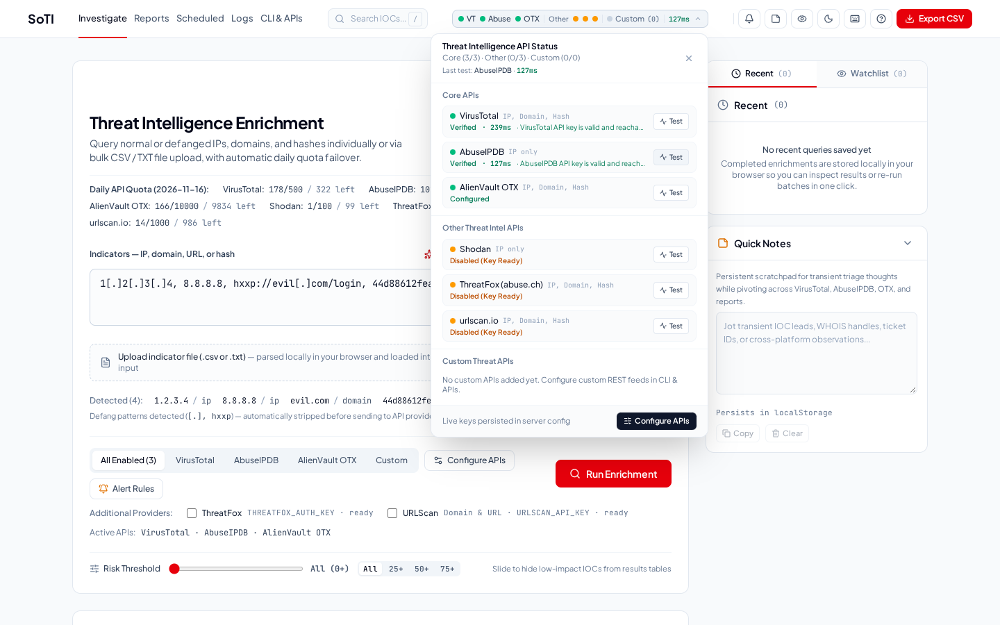

*Running inline **`Test`** checks updates the persistent TopBar status pill with the latest measured round-trip latency (`127ms`) and displays per-provider latencies side by side inside the **Threat Intelligence API Status** popover (`VirusTotal · 239ms`, `AbuseIPDB · 127ms`) to surface slow endpoints at a glance.*

### Global Search Dropdown `'Clear'` Recent History Action & Risk Preview
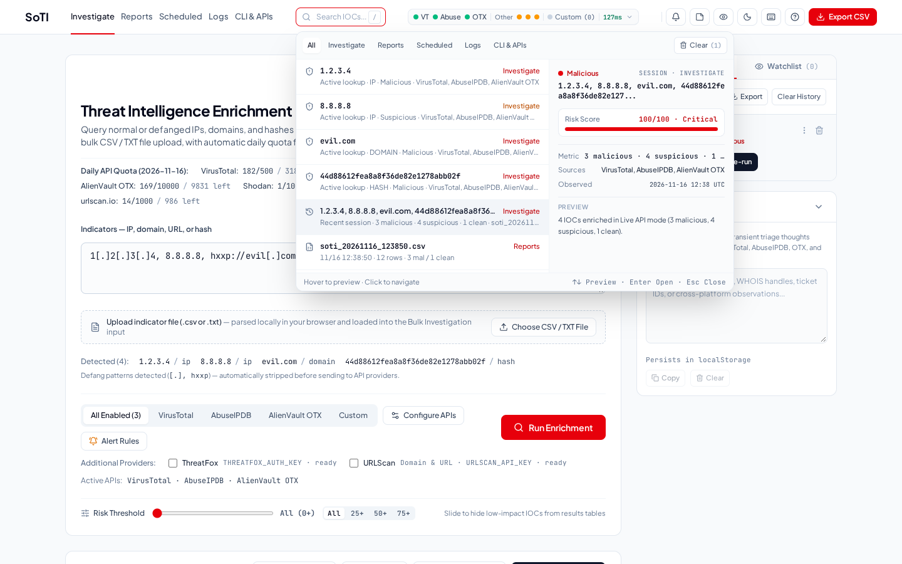

*The **Global Search** dropdown header includes a right-aligned **`Clear`** button (`Clear (1)`) to wipe persisted recent history from `localStorage` and keep the live search index clean alongside hover **Risk Metadata Preview** details.*

### `InvestigateView` Header `Share` Button & Investigation Context Sharing Dialog
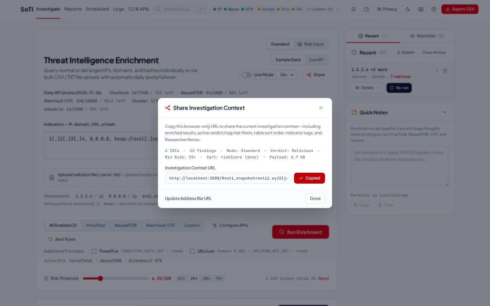

*Clicking **`Share`** in the **Threat Intelligence Enrichment** header opens the **Share Investigation Context** dialog showing the serialized `#soti_snapshot=...` browser link alongside active filter context (`Mode: Standard`, `Verdict: Malicious`, `Min Risk: 25+`, `Sort: riskScore (desc)`), payload size, **Copy Link** confirmation, and **Update Address Bar URL**.*

### Local CSV File Upload to Bulk Investigation Input (`Investigate` Tab)
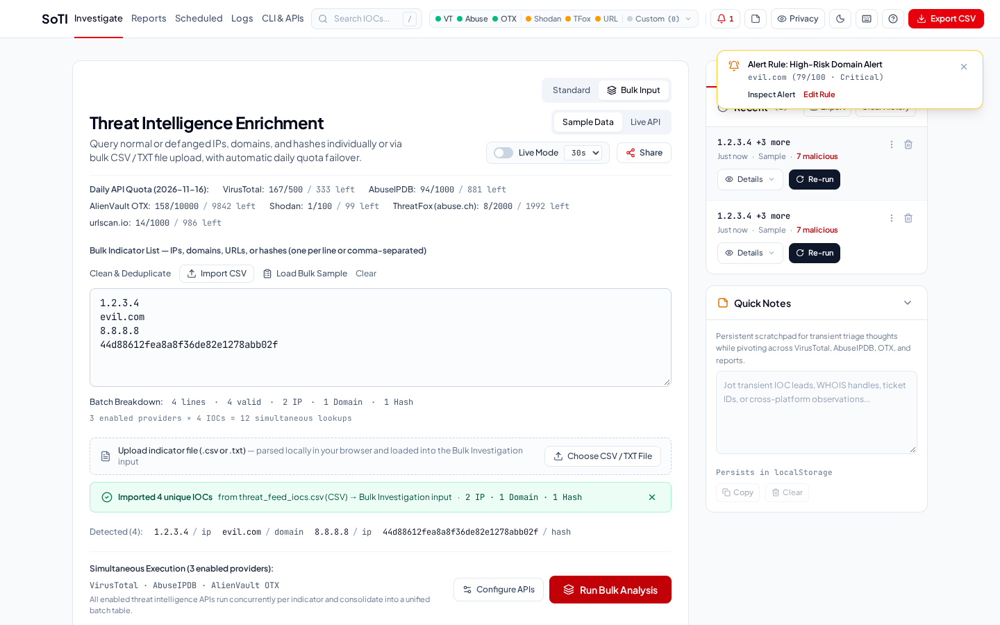

*Uploading a local CSV indicator file (`threat_feed_iocs.csv`) automatically switches the workbench to **Bulk Input**, populates the multi-line textarea with refanged newline-separated IOCs (`1.2.3.4`, `evil.com`, `8.8.8.8`, `44d88612...`), updates the live **Batch Breakdown**, and displays the confirmation banner ready for **Run Bulk Analysis**.*

### Global Search Hover Risk Metadata Preview (`TopBar`)
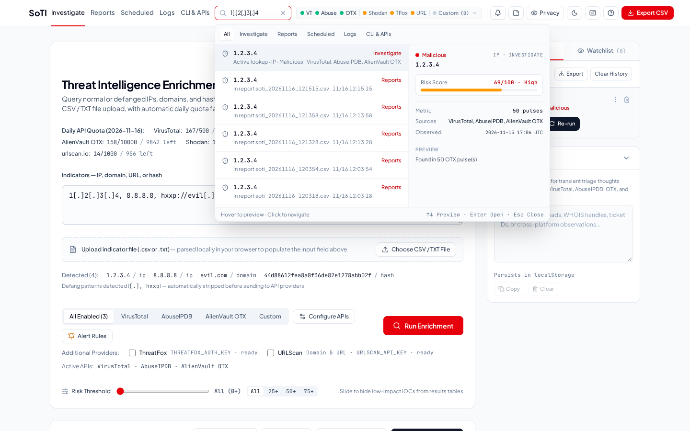

*Typing normal or defanged indicators (`1[.]2[.]3[.]4`) into **Global Search** and hovering any search result reveals an inline **Risk Metadata Preview** panel showing verdict status, weighted `0–100` confidence score meter (`69/100 · High`), primary detection metric, contributing sources, UTC timestamp, and finding snippet without navigating away.*

### Dashboard `Download Summary` Consolidated Risk PDF (`Reports` Tab)
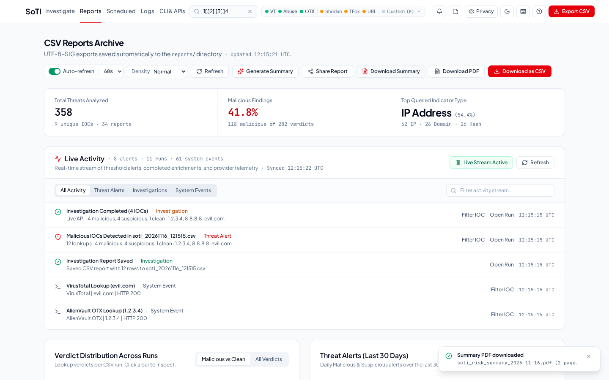

*Reports **CSV Reports Archive** toolbar featuring the **`Download Summary`** action next to **Download PDF** and **Download as CSV**, generating and downloading `soti_risk_summary_YYYY-MM-DD.pdf` with live confirmation toast (`2 pages`).*

### TopBar `Privacy Mode` IOC Redaction & Screen-Share Safe Mode
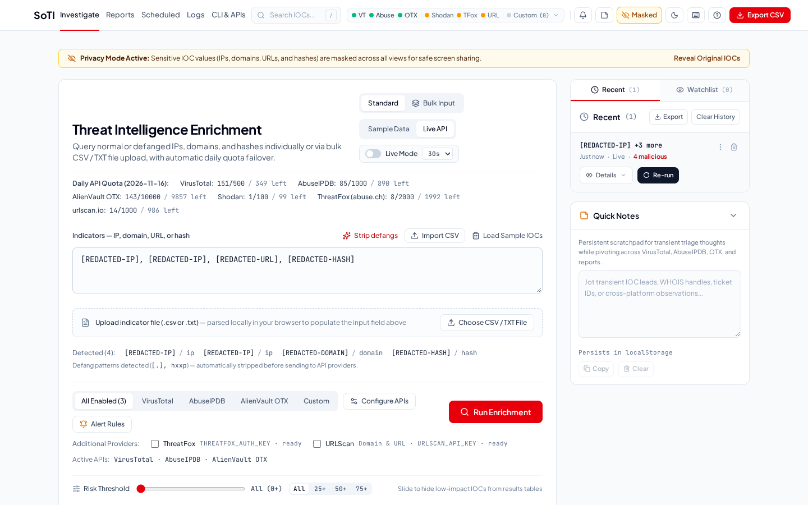

*Global **`Masked`** toggle in the **TopBar** activating the amber **`Privacy Mode Active`** banner and redacting sensitive indicators into `[REDACTED-IP]`, `[REDACTED-DOMAIN]`, `[REDACTED-URL]`, and `[REDACTED-HASH]` across the input box, detected IOC strip, Summary Matrix, D3 visualizations, and **Recent** history sidebar without mutating stored data.*

### Custom `Alert Rules` Panel, Rule Trigger History & Desktop Toast
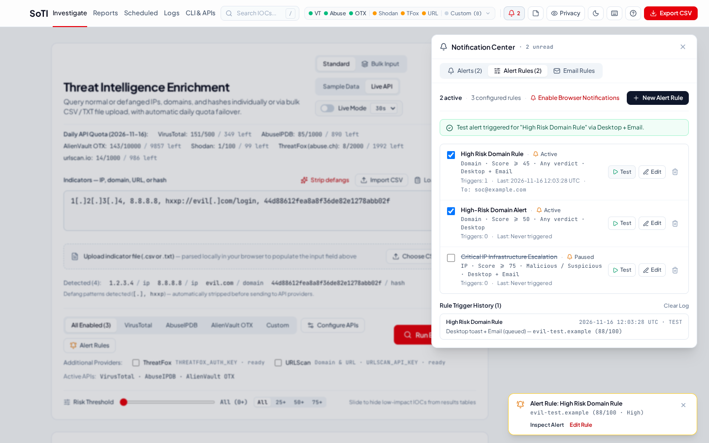

*Interactive **Alert Rules** manager inside the **Notification Center** displaying configured risk-threshold rules (`High Risk Domain Rule`, `Score ≥ 45`, `Desktop + Email`), one-click **`Test` / `Edit` / `Delete`** controls, persistent **Rule Trigger History**, and a live floating **Desktop Alert Rule Toast**.*

### TopBar Multi-Provider API Status & Interactive Popover
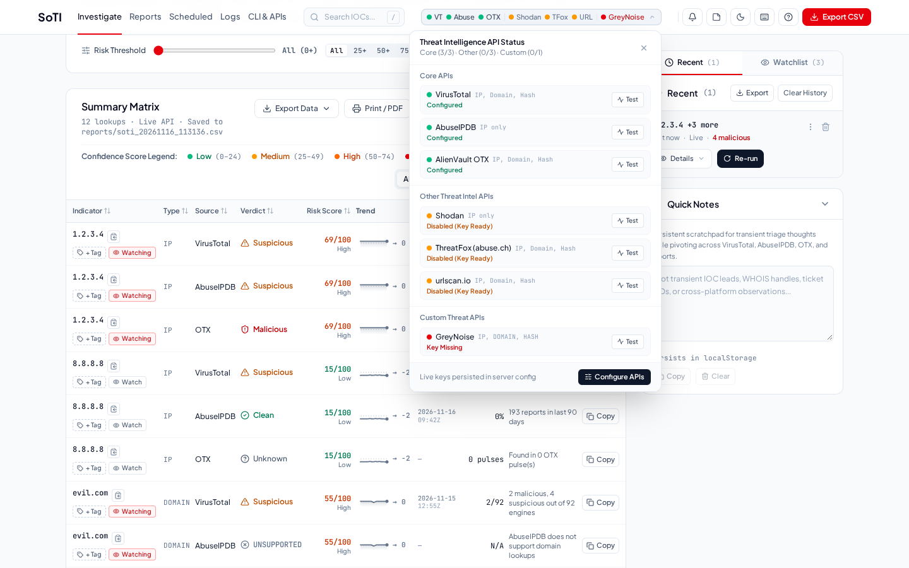

*Persistent header status bar displaying live indicators across **Core** (`VT`, `Abuse`, `OTX`), **Other Extended** (`Shodan`, `TFox`, `URL`), and **Custom** (`GreyNoise`) threat intel feeds, expanding into an interactive popover with inline per-provider **`Test`** connection checks and a **Configure APIs** shortcut.*

### Investigation Workbench & Input Controls
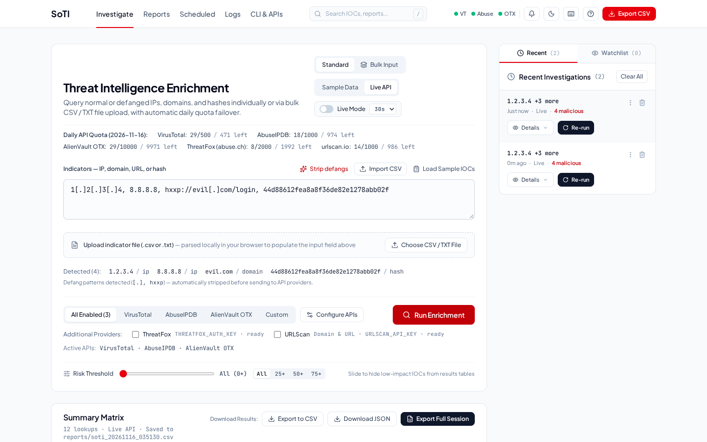

*Main **Investigate** workspace displaying the **Standard / Bulk Input** mode switcher, **Sample Data / Live API** execution controls, **Live Mode** background polling selector, live daily provider quota bars, automatic defanged IOC recovery (`1[.]2[.]3[.]4`, `hxxps://evil[.]com/login`), provider selector strip, **Risk Threshold** slider, and **Recent Investigations** history sidebar.*

### Results Matrix, Risk Threshold Slider, Quick Copy & Watchlist Toggles
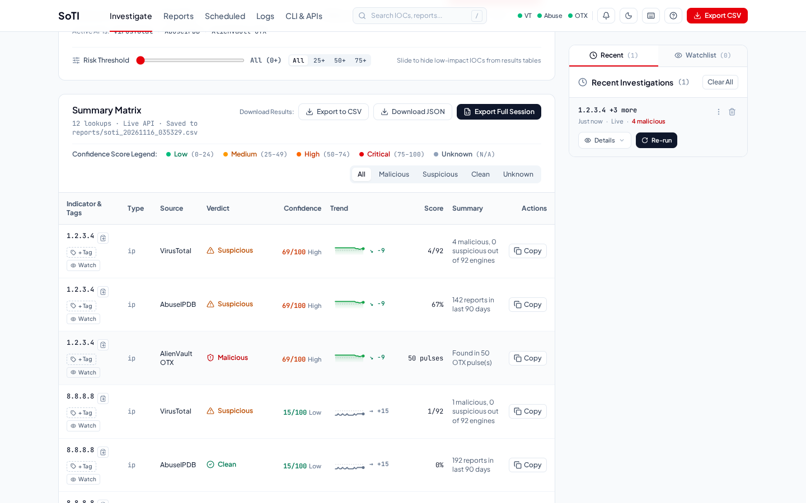

*Enriched **Summary Matrix** with clickable ascending/descending column sorting (**`Indicator`**, **`Type`**, **`Source`**, **`Verdict`**, **`Risk Score`**, **`Last Seen`**, **`Score`**), **Risk Threshold** confidence filter bar, per-row inline **Copy to Clipboard** buttons, active **`Watching` / `Watch`** IOC toggles backed by application state (`Watchlist (3)`), **`Recent`** sidebar **`Export`** / **`Clear History`** buttons, **`Session Snapshot`**, **`Export Data` (`CSV` / `JSON` / `TXT Report`)**, **`Print / PDF`**, and **`Export Full Session`** controls.*

### Recent Investigation History Export & Clear Confirmation Dialog
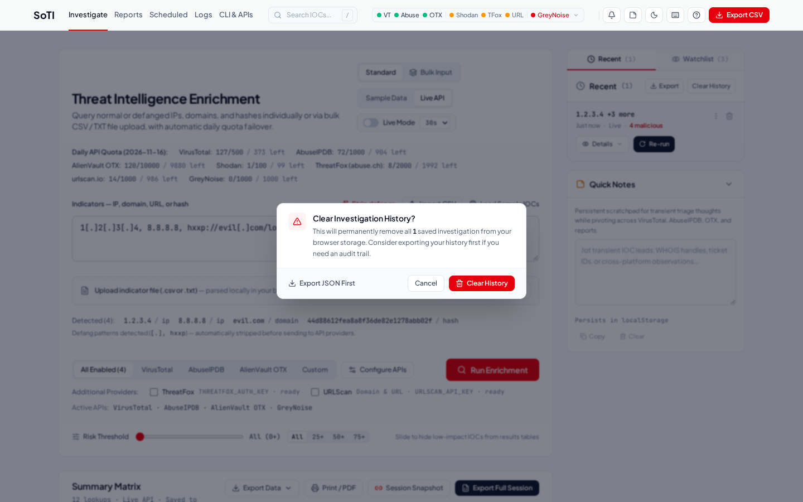

*Safeguarded **Clear Investigation History?** modal preventing accidental wipes of saved runs, featuring inline **`Export JSON First`** (to save investigation IDs and timestamps before clearing), **`Cancel`**, and **`Clear History`** actions.*

### Persistent `Quick Notes` Sidebar Panel
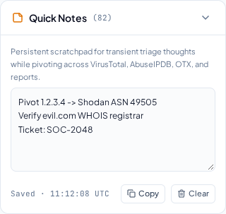

*Persistent **Quick Notes** scratchpad docked in the **Investigate** sidebar (and accessible from any tab via the top-bar **Quick Notes** drawer), automatically preserving transient analyst hypotheses in `localStorage` across browser reloads with live character counters, UTC save timestamps, **Copy**, and **Clear / Undo**.*

### Shareable Browser `Session Snapshot` Modal & Restoration
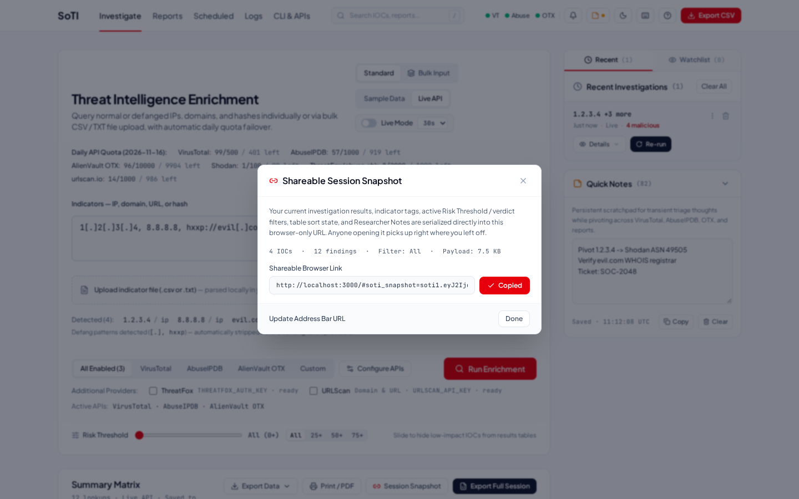

*Clicking **`Session Snapshot`** serializes the active investigation results, filters, sort order, tags, and Researcher Notes into a shareable browser-based `#soti_snapshot=...` link that restores the exact session state on open.*

### Real-Time `Live Activity` Scrollable Feed (`Reports` Dashboard)
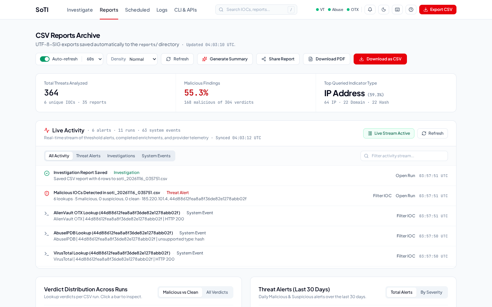

*Real-time **Live Activity** feed mounted beneath the SOC **Quick Stats** KPI cards on the **Reports** dashboard, showing **Live Stream Active** SSE status, alert/run/system-event counters, category filter tabs (`All Activity`, `Threat Alerts`, `Investigations`, `System Events`), inline search, and direct **Filter IOC** / **Open Run** pivots.*

### Dashboard D3 `Risk Score Heatmap` & Security Posture (`Reports` Tab)
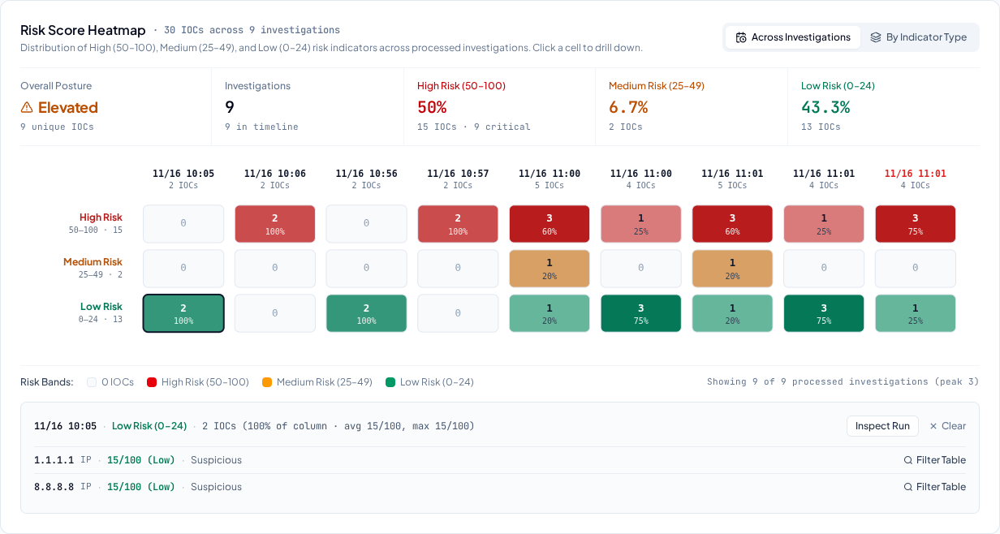

*D3 **Risk Score Heatmap** on the **Reports** dashboard plotting **High (`50–100`)**, **Medium (`25–49`)**, and **Low (`0–24`)** risk indicator counts and percentages across processed investigations (`Across Investigations` / `By Indicator Type`), featuring an **Overall Posture** KPI strip and clickable cells with **Inspect Run** and **Filter Table** drill-down.*

### Dashboard D3 `Relationship Graph` & Shared Infrastructure Hubs
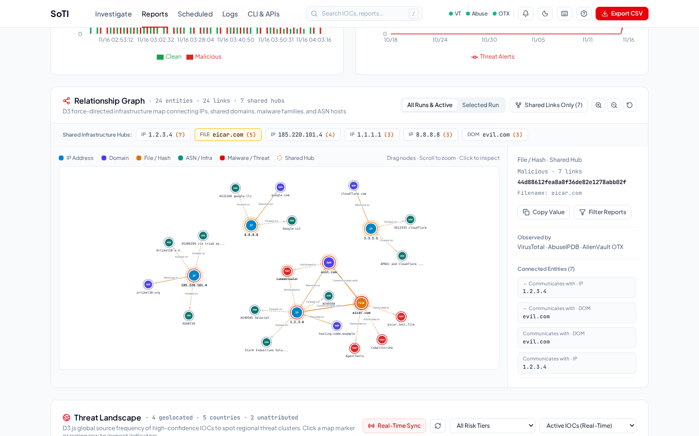

*Force-directed D3 **Relationship Graph** linking IPs, shared domains (`evil.com`), malicious file hashes (`44d88612fea8a8f36de82e1278abb02f` / `eicar.com`), ASNs, and malware families (`LummaStealer`, `CobaltStrike`, `AgentTesla`) with **Shared Infrastructure Hubs** spotlight buttons, **Shared Links Only** filtering, and the **Selected Entity Inspector**.*

### Real-Time D3 Threat Landscape World Map (`Reports` Tab)
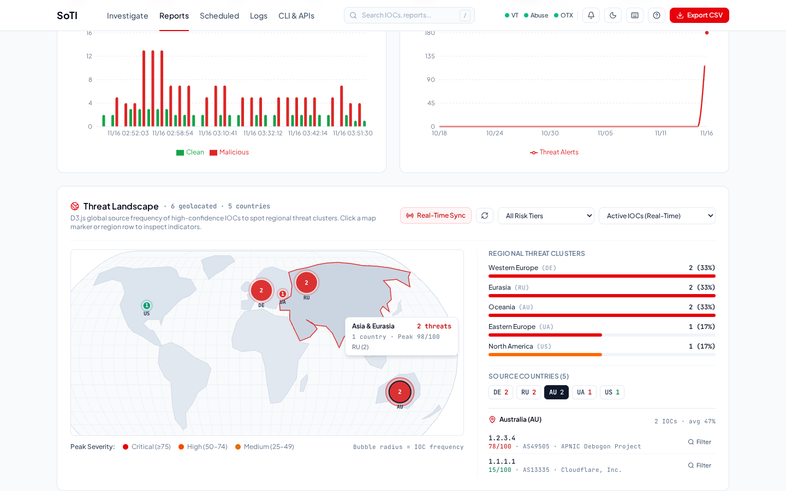

*Interactive Natural Earth **Threat Landscape** D3 widget on the **Reports** dashboard with **Real-Time Sync**, severity-colored origin clusters, hover highlighting on continental landmasses (showing live threat counts, peak risk score, and country breakdown), and **Regional Threat Clusters** drill-down cards.*

### Persistent IOC Watchlist & Status-Change Alerts
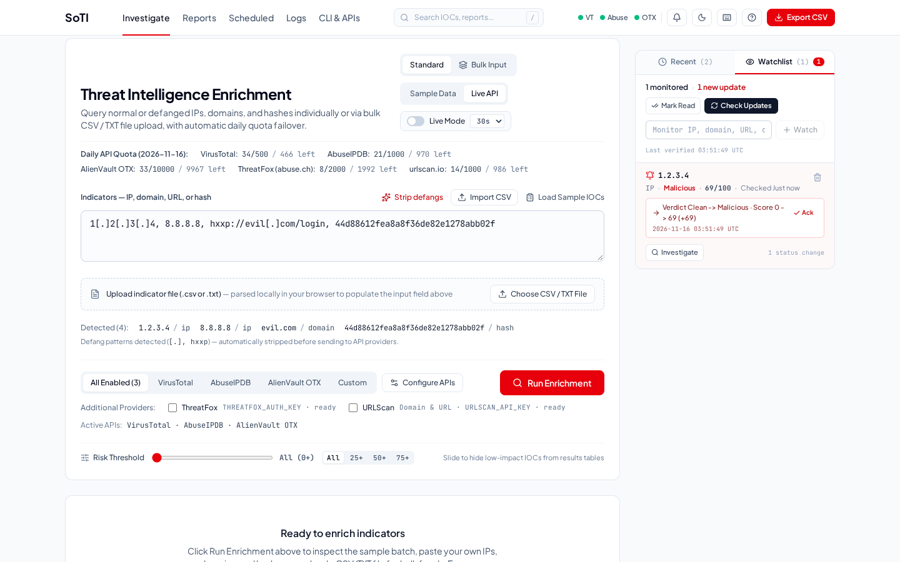

*Tabbed **Watchlist** sidebar showing an active unread **notification badge (`1`)**, tracked indicator verdict and confidence score (`1.2.3.4 · Malicious · 69/100`), status-transition delta banner (`Verdict Clean -> Malicious · Score 0 -> 69 (+69)`), and on-demand **Check Updates / Mark Read** controls.*

### GUI Threat-Intel API Key Manager & Quota Ledger (`CLI & APIs` Tab)
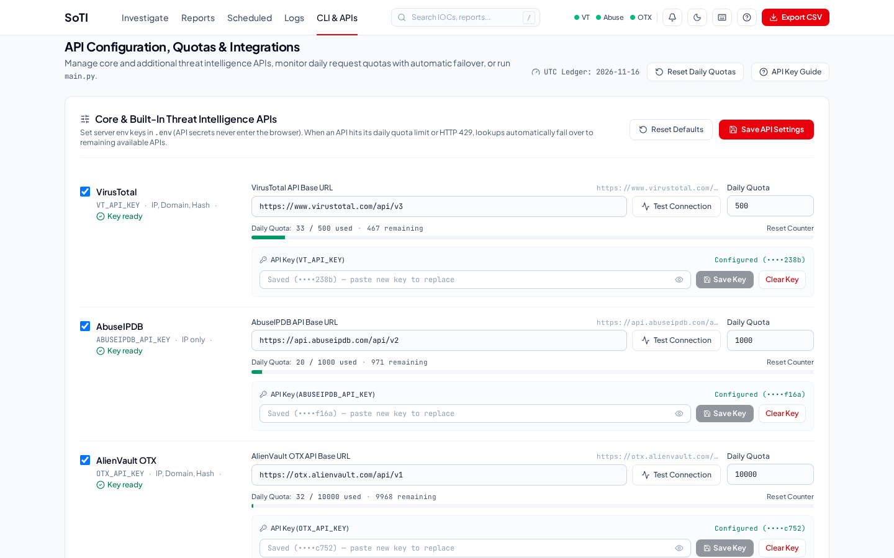

*Centralized **CLI & APIs** configuration view for saving, testing, masking (`••••238b`), or clearing provider API keys directly in the GUI alongside live daily quota meters and automatic failover rules.*

---

## 9. Source Support & Default Verdict Thresholds

| Source | IP | Domain | Hash | Malicious | Suspicious | Clean |
| :--- | :---: | :---: | :---: | :--- | :--- | :--- |
| **VirusTotal** | Yes | Yes | Yes | ≥ 5 engines | 1–4 malicious or any suspicious | 0 detections |
| **AbuseIPDB** | Yes | No | No | Confidence ≥ 75% | 25–74% | < 25% |
| **AlienVault OTX** | Yes | Yes | Yes | ≥ 5 pulses | 1–4 pulses | 0 pulses = `Unknown` |
| **ThreatFox / URLScan** | Yes | Yes | Yes | Active malware / verdict hit | Suspicious tag / score | Benign / no hit |

---

## 10. Directory Structure

```text
SoTI/
├── .github/
│   └── workflows/
│       └── main.yml                        # CI workflow for Python CLI & Node/React build
├── api/                                    # Python threat intelligence API clients
│   ├── __init__.py                         # IOC refanging & classification (ip/domain/hash/url)
│   ├── virustotal.py                       # VirusTotal v3 client
│   ├── abuseipdb.py                        # AbuseIPDB v2 client
│   └── alienvault.py                       # AlienVault OTX client
├── config/                                 # Runtime settings, schedules, quotas & alert state
│   ├── __init__.py
│   ├── settings.py                         # Paths, version, and Python CLI defaults
│   ├── scheduler.py                        # Recurring schedule evaluation engine
│   ├── email_alerts_config.json            # Threshold email alert rules
│   ├── email_alerts_log.json               # Dispatched alert history
│   ├── quota_usage.json                    # Daily provider quota ledger for failover
│   └── schedules.json                      # Persisted scheduled IOC checks
├── docs/
│   └── screenshots/                        # Curated Web Workbench UI screenshots for README.md
├── logs/                                   # Runtime audit logs (created at runtime)
│   └── soti.log
├── reports/                                # Saved enrichment CSV exports (created at runtime)
├── src/                                    # React + TypeScript + Tailwind CSS Web Workbench
│   ├── App.tsx                             # Root shell, Watchlist app state, API status wiring, theme, shortcuts, search
│   ├── index.css                           # Tailwind CSS configuration, design tokens & @media print rules
│   ├── main.tsx                            # React DOM mount entry point
│   ├── components/
│   │   ├── AlertRulesPanel.tsx             # Custom risk/verdict Alert Rules builder, tester & trigger history
│   │   ├── CliSetupView.tsx                # CLI setup, GUI API key manager, Alert Rules & custom sources
│   │   ├── ConfidenceSparkline.tsx         # Inline SVG historical confidence trend mini-sparkline
│   │   ├── EmailAlertSettingsPanel.tsx     # Threshold-based SMTP alert rules UI
│   │   ├── HelpModal.tsx                   # Workbench onboarding & provider setup guide
│   │   ├── IndicatorFileUpload.tsx         # Local .csv/.txt IOC upload, parser & Bulk Investigation loader
│   │   ├── InvestigateView.tsx             # Header Share dialog, Standard/Bulk Input, CSV-to-bulk, Live Mode, Watch toggles, auto-saved notes, Print/PDF, exports
│   │   ├── IocEventTimeline.tsx            # Chronological UTC activity timeline component
│   │   ├── IocNetworkGraph.tsx             # D3 force-directed IOC relationship graph
│   │   ├── IocRegionHeatmap.tsx            # D3 interactive geographic IOC heatmap & filter
│   │   ├── KeyboardShortcutsModal.tsx      # Categorized global shortcuts reference 
│   │   ├── LiveActivityFeed.tsx            # Real-time SSE scrollable alerts & telemetry feed
│   │   ├── LogsView.tsx                    # Real-time audit & failover log viewer
│   │   ├── NotificationCenter.tsx          # Quota warnings, Alert Rules drawer & Desktop Rule Toasts
│   │   ├── PrivacyModeContext.tsx          # Global React context sharing Privacy Mode IOC redaction state
│   │   ├── QuickNotesSidebarPanel.tsx      # Persistent localStorage Quick Notes panel & slide-over drawer
│   │   ├── RecentInvestigationsSidebar.tsx # History sidebar, JSON Export, Clear History dialog, pin/rename/tag/region filter
│   │   ├── RelationshipGraphWidget.tsx     # Dashboard D3 force-directed IOC relationship graph
│   │   ├── ReportsView.tsx                 # KPIs, charts, Live Activity, Risk Score Heatmap, Relationship Graph & Share modal
│   │   ├── RiskScoreHeatmap.tsx            # D3 High/Medium/Low risk score heatmap across processed investigations
│   │   ├── ScheduledView.tsx               # Recurring schedule manager & rule evaluation UI
│   │   ├── ThreatLandscapeWidget.tsx       # Real-time D3 world map, region hover & threat clusters
│   │   ├── TopBar.tsx                      # Navigation tabs, API status & latency bar, Privacy Mode toggle, Global Search + Clear history, & theme
│   │   └── WatchlistSidebarTab.tsx         # Persistent IOC watchlist monitor & update badge UI
│   └── utils/                              # Pure TypeScript business logic & node:test suites
│       ├── alertRules.ts / .test.ts        # Custom Alert Rule validation, evaluation & trigger history
│       ├── apiConfig.ts / .test.ts         # Threat-intel key validation, masking, latency classification & provider rules
│       ├── bulkAnalysis.ts / .test.ts      # Multi-IOC batch runner state & progress
│       ├── bulkCsv.ts / .test.ts           # CSV/TXT IOC extraction, refanging & newline Bulk Input formatting
│       ├── clipboard.ts                    # Safe clipboard helper
│       ├── confidenceTrend.ts / .test.ts   # Historical confidence series & emerging threat analyzer
│       ├── emailAlerts.ts / .test.ts       # Confidence threshold alert evaluation
│       ├── enrichmentProviders.ts/.test.ts # Shodan, ThreatFox & URLScan parsers/samplers
│       ├── globalSearch.ts / .test.ts      # Cross-workbench search index, defang normalization & hover risk previews
│       ├── heatmapAnalytics.ts / .test.ts  # Geographic region aggregation & history filter
│       ├── indicators.ts / .test.ts        # Frontend IOC parser & validator
│       ├── investigationHistory.ts/.test.ts# Local history store, pin/rename/delete helpers
│       ├── iocGraph.ts / .test.ts          # Network graph node/edge transformation
│       ├── iocTags.ts / .test.ts           # Custom IOC tag CRUD & filter logic
│       ├── iocTimeline.ts / .test.ts       # Chronological timestamp extractor & sorter
│       ├── keyboardShortcuts.ts / .test.ts # Shortcut key matching & spec registry
│       ├── liveActivity.ts / .test.ts      # Real-time activity event parsers, mergers & filters
│       ├── livePolling.ts / .test.ts       # Live Mode polling intervals, countdown & delta tracking
│       ├── notesAutoSave.ts / .test.ts     # Researcher Notes periodic localStorage auto-save helpers
│       ├── notifications.ts / .test.ts     # Quota threshold & alert notifications
│       ├── privacyMode.ts / .test.ts       # Privacy Mode IOC detection, redaction & storage helpers
│       ├── quickNotes.ts / .test.ts        # Quick Notes localStorage persistence & state helpers
│       ├── quota.ts / .test.ts             # Daily quota & failover calculation
│       ├── reportPdf.ts / .test.ts         # jsPDF + consolidated risk summary & chart export builders
│       ├── reportSharing.ts / .test.ts     # Expiring report snapshot & clipboard formatter
│       ├── reportsAnalytics.ts / .test.ts  # Verdict, confidence, and 30-day trend aggregation
│       ├── resultsExport.ts / .test.ts     # Visible table CSV, JSON & formatted TXT report builders
│       ├── resultsTable.ts / .test.ts      # Results table column sorting & Last Seen UTC extraction
│       ├── riskScoreHeatmap.ts / .test.ts  # High/Medium/Low risk heatmap & posture aggregation
│       ├── riskScoring.ts / .test.ts       # Weighted multi-provider confidence scoring
│       ├── scheduler.ts / .test.ts         # Frontend schedule interval formatting
│       ├── sessionExport.ts / .test.ts     # Portable full-session JSON serializer
│       ├── sessionSnapshot.ts / .test.ts   # Shareable browser URL investigation context (filters + results) encoder/decoder
│       ├── theme.ts / .test.ts             # Light/Dark theme persistence
│       ├── threatLandscape.ts / .test.ts   # D3 world map region summaries & cluster aggregation
│       └── watchlist.ts / .test.ts         # Persistent watchlist state & status-change evaluator
├── tests/
│   └── test_soti.py                        # Python CLI unit tests
├── .env.example                            # API key & optional SMTP/Gemini template
├── .gitattributes                          # Line-ending & binary PNG attributes for GitHub rendering
├── index.html                              # HTML entry document
├── main.py                                 # Python CLI entry point
├── package.json                            # Node dependencies & scripts (`dev`, `build`, `start`, `lint`)
├── requirements.txt                        # Python dependencies
├── server.ts                               # Express API server & Vite host (port 3000)
├── tsconfig.json                           # TypeScript compiler configuration
├── vite.config.ts                          # Vite configuration
└── README.md                               # Project documentation
```

---

## 11. Testing & Verification

```bash
# TypeScript unit tests, ESLint/type check, and production bundle
npx --yes tsx --test src/utils/*.test.ts
npm run lint
npm run build

# Python CLI syntax check & unit tests
python -m py_compile main.py api/*.py config/*.py tests/*.py
python -m unittest discover -s tests -v
```

---

## Disclaimer

For defensive security operations and authorized SOC triage use only.
